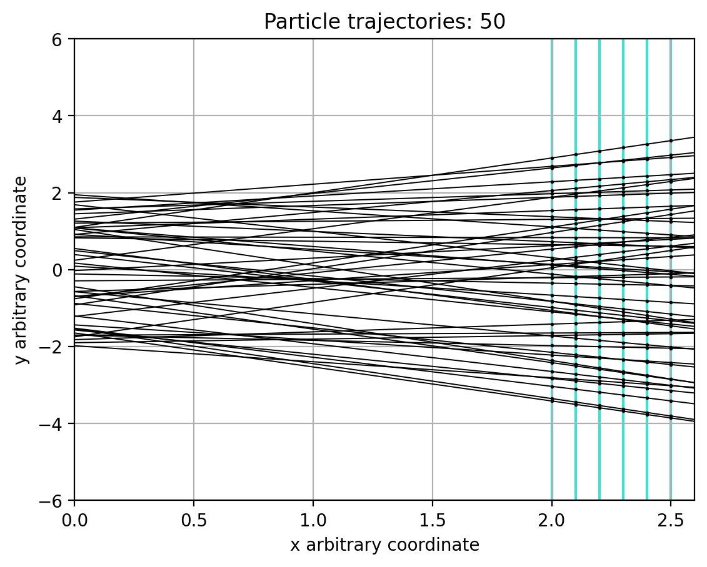
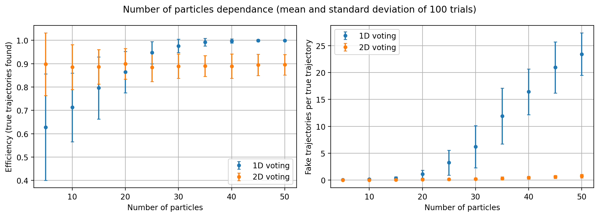
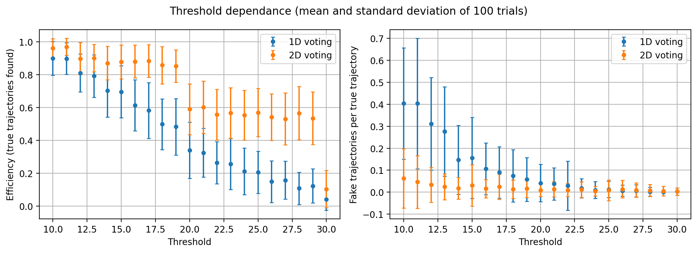

# Particle track reconstruction with the Hough transform

This project simulates particles passing through a planar detector and reconstructs their straight trajectories from the detected hits using the Hough transform and a voting system. It was my final project for the Scientific Computing Lab at the University of Birmingham (November 2024), during my exchange. Everything is in TrackFindingNotebook.ipynb.



The 50 trajectories found in the ideal scenario. The hits are the points on the detection planes (in blue) and the lines are the trajectories calculated from them.

## How it works

The detector has 6 detection planes between x = 2 and x = 2.5. Each particle follows a line y = mx + b, with m and b drawn uniformly from [-1, 1] and [-2, 2]. The hits are the intersections of these lines with the planes. Two scenarios are simulated: an ideal one (continuous planes, no noise, 100% efficiency) and a real one, where the planes are split in 5000 detection elements, each hit is recorded with 90% probability and there is a 1% probability of a noise hit.

Each hit (x, y) becomes a line b = y - mx in the Hough space (m, b). The lines of the hits of one particle cross at the m and b of that particle, so the intersections of all the Hough lines are found and the Hough space is divided in bins. Bins with more intersections than a threshold are accepted as trajectories.

## Changes after the original project

In the original project the algorithm was evaluated with the proportion of detected to real particles. That number counts a fake trajectory the same as a real one, so I added an evaluation that compares every detected trajectory with the true ones (a detected trajectory is correct if its m and b are within 0.05 and 0.1 of a true one). This gives two numbers: the efficiency (true trajectories found) and the fake trajectories per true trajectory.

With this evaluation it was clear that the original voting system creates many fake trajectories. It uses one histogram for m and one for b, and every accepted m bin is combined with every accepted b bin, so with k particles there can be up to k² trajectories and most of them do not exist. I added a second voting system with a 2D histogram of the (m, b) space, where each bin is summed with its neighbours and only the local maxima are accepted. The original method is still in the notebook as method='1D' and every analysis compares both.

I also fixed two errors that made the algorithm return no trajectories (or fail) when there was only one accepted bin or all the intersections were in the same point, added a random seed and joined the six statistics functions in one.

## Results

Mean of 100 trials in the real scenario (100 bins, threshold 15):

| Particles | Voting | Efficiency | Fake trajectories per true trajectory |
|---|---|---|---|
| 10 | 1D (original) | 0.71 | 0.15 |
| 10 | 2D | 0.89 | 0.02 |
| 50 | 1D (original) | 1.00 | 23.5 |
| 50 | 2D | 0.90 | 0.7 |

With the original method the efficiency gets close to 1 as the number of particles increases, but only because it accepts so many combinations that the real trajectories are always included: with 50 particles it finds more than 1,000 trajectories. The 2D voting keeps the efficiency around 0.9 for any number of particles and the fake trajectories below 1 per true trajectory.




The threshold controls the balance between finding every trajectory and accepting fake ones. A lower threshold finds more trajectories but also more fakes, for both methods. With the 2D voting the efficiency drops from 0.85 to 0.59 between a threshold of 19 and 20: each pair of hits gives two intersections, so a particle with 5 hits gives 20 intersections, and with a threshold of 20 every particle that lost one hit is missed.



The detector efficiency has the biggest effect of the detector parameters (2D voting efficiency from 0.67 at 80% to 0.99 at 100%). In the tested ranges, the noise (0 to 10%) and the number of detection elements (5,000 to 10,000) have almost no effect. The figures for the number of bins, detection elements, detector efficiency and noise are in the figures folder.

## Limitations

- The tolerance used to decide if a trajectory is correct (0.05 in m and 0.1 in b) is a choice; with many detected trajectories some fake ones can fall close to a true one by chance.
- The 2D voting also starts to give fake trajectories with many particles (0.7 per true trajectory with 50), so the number of bins and the threshold have to be adjusted to the number of particles.
- The intersections are found by comparing every pair of Hough lines in Python, which is slow with many hits.
- Only straight trajectories in 2D are simulated.

## How to run

```
pip install -r requirements.txt
jupyter lab
```

Run all the cells of TrackFindingNotebook.ipynb. The statistics take around 2 hours, most of it in the number of particles analysis with the original voting system. The notebook is saved with its outputs, so the results can be read on GitHub.
